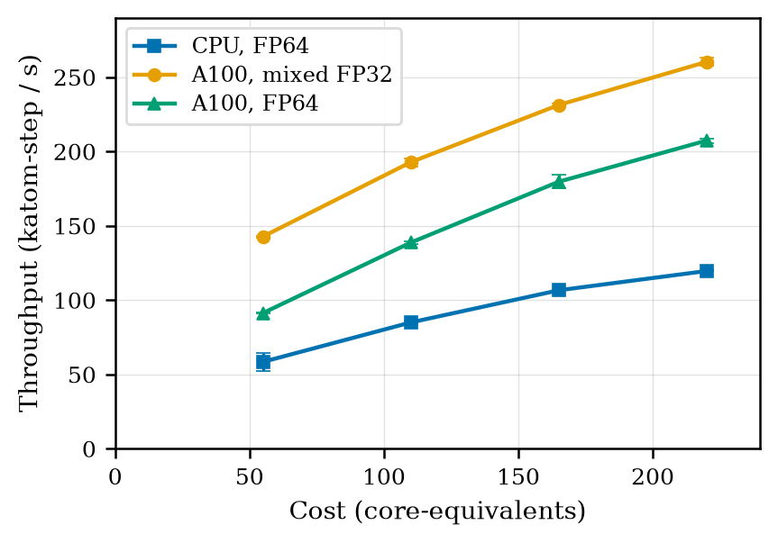
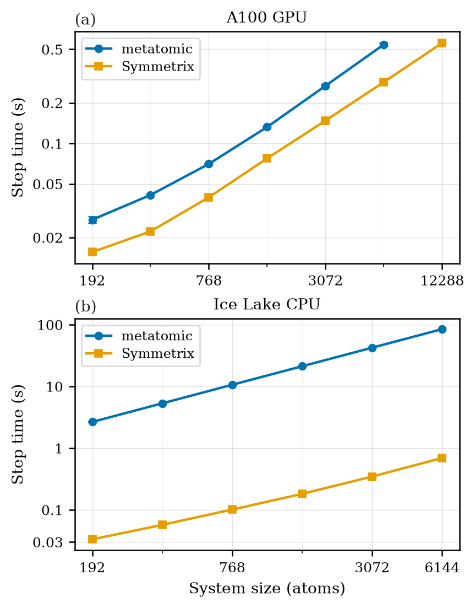

# Provenance and citation

## Why this exists

CP2K-FORGE is not a standalone idea; it is the last step of a specific research arc,
and the arc is why it is built the way it is.

The starting point was CP2K's native high-dimensional neural network potential
(HDNNP) evaluator on CPU: a prior report removed its neighbour-search bottleneck and
restored near-linear scaling with system size, a change later **accepted upstream into
CP2K** ([PR #5295](https://github.com/cp2k/cp2k/pull/5295)). That left descriptor
evaluation, neural-network inference and force accumulation as the dominant remaining
cost, the direct motivation for moving the evaluator onto GPUs. In double precision
the GPU path preserves exact parity with the CPU reference; in mixed precision it
reaches **2.2-2.4× the equal-cost CPU throughput** (1.6-1.7× in double precision):



*Iso-cost throughput of native HDNNP dynamics for H₂O-16384. One A100 is costed at 55
CPU core-equivalents; GPU points use one to four A100s. Values are warm-up-excluded
steady-state means over five allocations.*

With a fast learned-force evaluator in hand, CP2K was then extended to the MACE model
family through two backends (metatomic for portable exported models, Symmetrix for
fast torch-free compact-model evaluation
([PR #5739](https://github.com/cp2k/cp2k/pull/5739), draft)), each with a different
GPU/CPU step-time profile:



*Steady-state step time against system size for metatomic and Symmetrix,
MACE-OMAT-0 small, on one A100 GPU and a 32-thread Ice Lake CPU node.*

Only once MACE was an ordinary CP2K force term did the natural next question follow:
**can CP2K build a compact model as well as run it?** CP2K-FORGE answers that: a
foundation model proposes configurations, CP2K labels selected frames with DFT, a
compact MACE trains on those labels, and CP2K validates and deploys it through the
same force interface it already had. Bulk water and fluoride in water were chosen as
the two validation systems specifically because the aqueous committee-potential
literature gives demanding, pre-existing references for force accuracy, liquid
structure and dynamics (a neutral hydrogen-bond network and a charged solvation
environment), without turning the validation into a broad benchmark survey.

The practical payoff, in the thesis's own words: *"CP2K-FORGE can take a researcher
from one configuration file to a validated domain-specific potential on the timescale
of a day, with CP2K providing the DFT labels, validation scores and provenance."*

## Where this code comes from

CP2K-FORGE was developed as part of an MPhil project at the University of Cambridge,
Department of Physics, and extracted into this standalone repository from the
author's CP2K development fork (`cp2k-mlp`, branch `mace-distill-pipeline`, which
stays frozen as report provenance). The accompanying thesis is

> Dhruv Sharma, *Machine-Learned Interatomic Potentials in CP2K with GPU Acceleration,
> MACE Integration and CP2K-FORGE for Domain-Specific Models*, MPhil thesis, Department
> of Physics, University of Cambridge, 2026.

The [case studies](../case-studies/index.md) reproduce that report's Chapter 4 FORGE
results; the figures and raw data under `docs/assets/` are vendored verbatim from the
report's data package (*Report 2 data package*, v1.1, 2026-08-13, CC BY 4.0); see the
[provenance manifest](../assets/README.md) for the file-by-file mapping.

## How to cite

`CITATION.cff` at the repository root carries the machine-readable citation (GitHub's
"Cite this repository" button uses it).

## The released model

The v0.1.0 release ships one trained model as an asset:

**`water64_pass6_stagetwo.model`**: a compact water MACE (96 channels, L = 2,
r_max = 5.0 Å, ZBL pair repulsion, float64), the final model of the **semi-local
revPBE-D3** `water64_tmd` campaign: pass 6, 70 labels, held-out force RMSE
59.46 meV/Å on that campaign's frozen 50-frame set (force score 91.9%, RDF/VDOS
self-convergence 98.9/98.8, flash density probe 0.97 g/cm³).

Honest caveats, so the asset is never over-read:

- it was **accepted by user decision at pass 6** (a GPU-budget call), not by the
  automated convergence rule;
- it is **not** the report's headline model; the headline campaigns are hybrid
  revPBE0-D3 and their weights ship with the report data package;
- density/TMD language for anything run with it follows the
  [claim constraints](../guide/showcase-density.md).

Load it with `mace.calculators.MACECalculator(model_paths=..., device=...)`.

SHA-256:

```text
11501d1fe7c0f17d9af2a787fbaf430f78f9f9bec1047061d818d402219abf7e
```

## Licensing

- Code: [MIT](license.md).
- Vendored documentation assets (`docs/assets/`): CC BY 4.0, © 2026 Dhruv Sharma.
