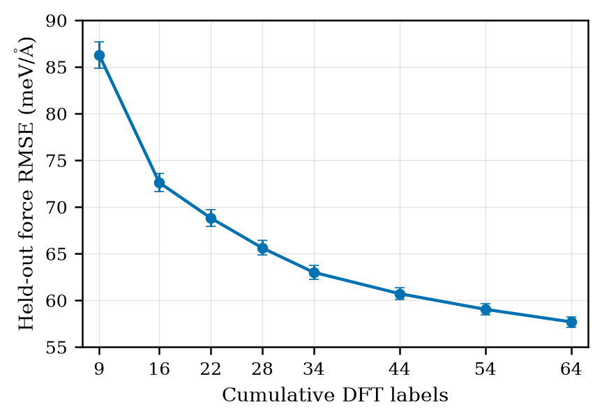
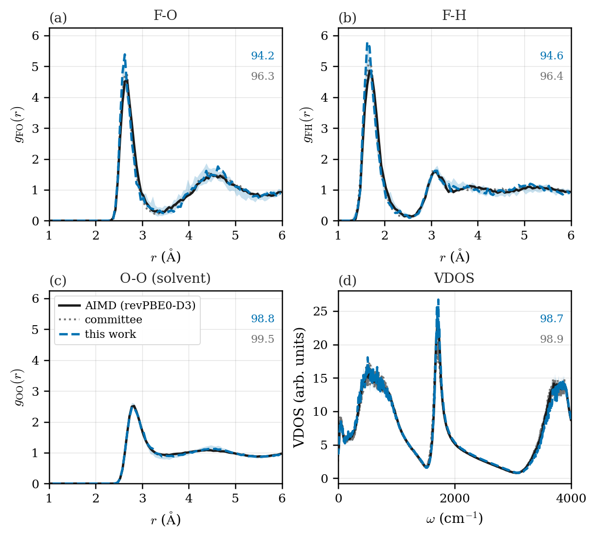

# Fluoride in water

**Headline: a competitive charged-cell model from 64 labels (about a fifth of the
committee's target-level labels) with the campaign's most instructive lesson: labels
alone are not enough; *where* they are sampled controls the observables.**

The system is the published single-fluoride-in-64-water cell: 193 atoms in a 12.445 Å
cube, adopted exactly via `system.seed_xyz`. It is stringent because the chemically
important signal concentrates around one ion that contributes little to aggregate force
scores. *(Thesis §4.3.2, see [provenance](../about/provenance.md); raw data:
[`convergence.json`](../assets/data/fluoride/convergence.json),
[`gates_by_pass.json`](../assets/data/fluoride/gates_by_pass.json),
[`species_by_pass.json`](../assets/data/fluoride/species_by_pass.json),
[`coordination_scores.json`](../assets/data/fluoride/coordination_scores.json).)*

## Swapping the sampler without touching the physics

The sampler here is MACE-MP-0 + D3 rather than the organic-systems foundation model used
for water exploration, which is not intended for charged aqueous species. The point of
the architecture is that this switch **changes only candidate generation**: every
training energy and force still comes from CP2K Quickstep at the same revPBE0-D3 level.
Because the sampler does not define the reference labels, it can be replaced
mid-campaign without changing the target method.

## The learning curve

The label set grows over eight passes, 9 → 64 frames. On the frozen 37-frame validation
set, force RMSE falls **86.3 → 57.7 meV/Å**, and the campaign stops automatically: the
last two improvements carry bootstrap upper edges of 1.86 and 1.51 meV/Å, inside the
pre-registered 2.0 meV/Å band. Pass 8 is a convergence decision, not a manual cutoff.

(fluoride-on-policy-recovery)=
## The on-policy recovery: the pass history is the result

During the five foundation-sampled passes, labels improve held-out forces by 27% (86.3 →
63.0 meV/Å) while the five-pair RDF agreement with the revPBE0-D3 AIMD reference
**drifts down, 95.3 → 93.4%**: the labels are target-level, but not yet spent in the
region that controls the solvation-shell observables. Switching to compact-model
sampling reverses this: the RDF overlap jumps to 96.7% and finishes at **97.2%**, with
the hydrogen VDOS following to **98.7%**.

> The sampler can find candidate regions at low cost, but the deployed model eventually
> has to sample the distribution on which it will be judged.

The recovery has the expected locality (the solvent network gains most; F-O and F-H
improve more slowly; one fluoride provides few shell configurations per frame), and
robustness improves alongside: two of eight velocity seeds failed a mid-campaign screen,
while all eight accepted pass-8 replicas run stably (closest O-O approach 2.53 Å).

*Accepted 64-label model (dashed), revPBE0-D3 AIMD (solid), published committee
(dotted); the band spans the eight stable velocity-seed replicas. The committee curves
here use its full deposited 50 ps run, so its printed VDOS (98.9) sits above the
length-matched 11 ps value (97.7) used in the table.*

## Head-to-head with the committee

| Measure (hybrid revPBE0-D3) | This work | Committee |
| --- | --- | --- |
| Force RMSE, 37 shared frames (meV/Å) | **57.7** | 69.4 |
| RDF overlap vs AIMD, five-pair (%) | 97.2 | 97.7 |
| Hydrogen VDOS overlap vs AIMD (%) | **98.7** | 97.7 |
| F-O coordination number (AIMD: 5.4) | 5.2 | 5.1 |
| Training labels | **64** | 299 |

The most independent force check: on **298 committee-AIMD frames never used in this
work's training, the accepted model reaches 46.8 meV/Å**, lower than on its own
held-out frames (which, being shared, also govern convergence). The committee's RDF/VDOS
are measured on the trajectory its training set was drawn from, so those observables are
not fully out-of-sample for it.

## Honest limits

- **The species breakdown is uneven.** The compact model is better on solvent forces;
  the committee remains better on fluorine. One ion in 193 atoms carries little weight
  in aggregate force RMSE, so **the campaign can stop while the ion force is still
  improving fastest**, a stated limitation of the aggregate convergence rule. The
  concrete next step is a species-weighted rule, not a new sampler.
- **The ion shell sits slightly too close**: the first F-O and F-H peaks are one
  histogram bin nearer the ion than AIMD, and the committee keeps the better ion-centred
  RDF overlaps.
- **One campaign cannot decompose the recovery** into sampler, label count and
  retraining; a foundation-sampled arm at 64 labels would be needed for that.
