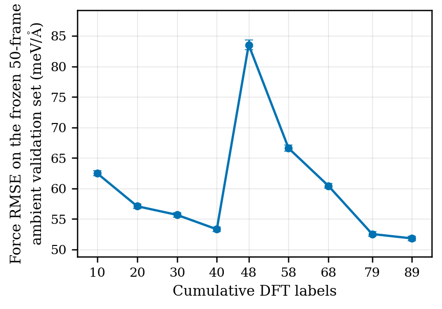
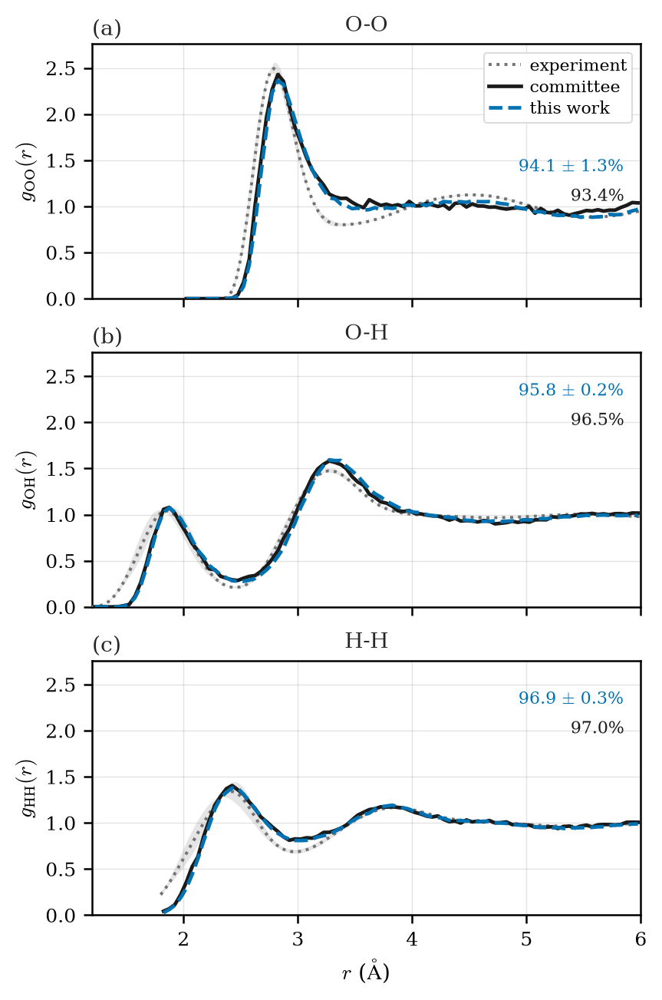
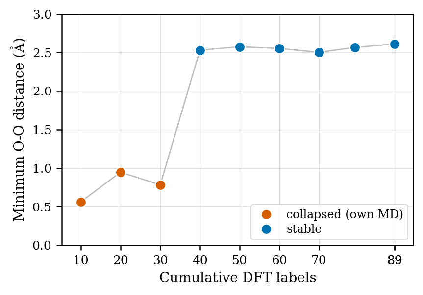
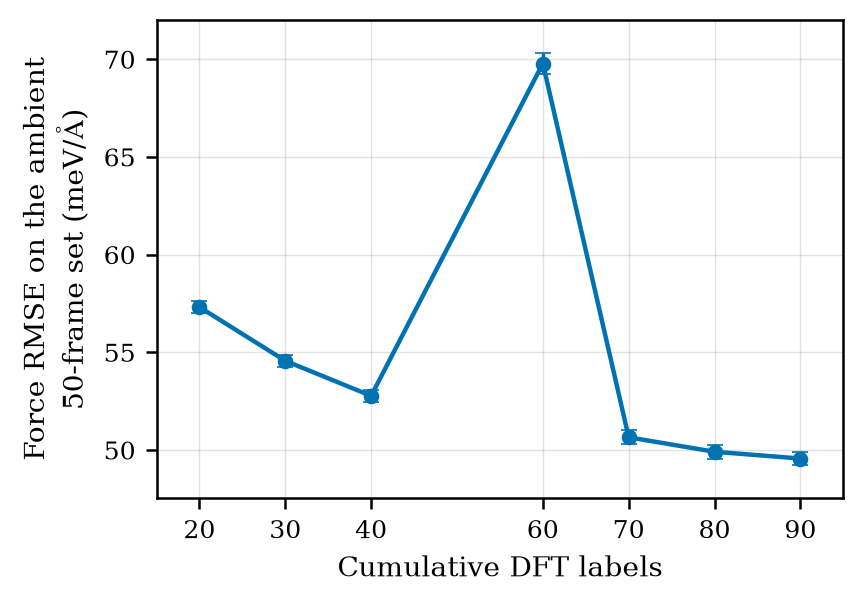
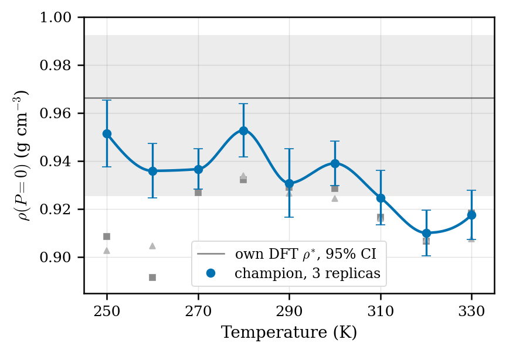

# Bulk liquid water

**Headline: a converged, accepted compact water model after 89 hybrid-DFT labels**, against a published committee potential trained on 814 structures selected from a 300 ps
parent ab initio trajectory. The question the campaign asks is deliberately narrow: can
*selected single points* recover the shared ambient target without inheriting that
trajectory?

*(Thesis §4.3.1, see [provenance](../about/provenance.md); raw data: [`water_learning_curve.csv`](../assets/data/water/water_learning_curve.csv),
[`water_stability.csv`](../assets/data/water/water_stability.csv),
[`water_ambient_audit.csv`](../assets/data/water/water_ambient_audit.csv).)*

## The learning curve

The validation set is 50 frozen ambient structures from the committee's own test
distribution, **relabelled at this work's exact CP2K settings** (the deposited labels use a
different Hamiltonian and are never mixed in). On that set, force RMSE falls from **62.5 ± 0.42
meV/Å at 10 labels to 51.8 ± 0.38 at 89 labels**.

The last two valid passes improve on their immediate predecessors by 1.42 and 0.72
meV/Å, with bootstrap intervals [1.32, 1.52] and [0.65, 0.78]: both upper edges sit
below the pre-registered 2.0 meV/Å band, so the campaign stops: **the pre-registered
rule fired**; this was a convergence decision, not a manual cutoff
([how the rule works](../guide/validation.md#convergence-a-pre-registered-plateau-rule)).
The transient rise at 48 labels marks the first compact-model-sampled batch; later
passes recover below the best pre-switch value. Passes under the eight-label validity
floor are never drawn and never deployed, but still enter the improvement sequence the
rule tracks.

## Head-to-head with the committee

On the 55 held-out frames shared with the committee deposit, scored on this work's
labels (the two labelling protocols differ by a measured ~55 meV/Å offset, so
cross-protocol numbers are never mixed):

| Measure (hybrid revPBE0-D3) | This work | Committee |
| --- | --- | --- |
| Force RMSE, shared frames (meV/Å) | **53.3** | 64.6 |
| RDF overlap vs 298 K experiment (%) | 95.6 | 95.6 |
| Training labels | **89** | 814 |

The compact model also holds up away from its own distribution: **44.3 meV/Å (score
94.4%) on 500 committee-distribution frames** never used in training.

## Structure against experiment

For water, structure is the more direct test of whether those force errors matter. On
the three-pair RDF overlap with the merged 298 K neutron and X-ray experiment (independent of either fitted model) the two models are essentially tied:

The small shared mismatch (a modestly low first O-O peak, an insufficiently deep first
minimum) appears in *both* models, so it is more consistent with the classical-nuclei
revPBE0-D3 reference itself than with a failure of the compact fit.

## The stability gate

Why the workflow needs more than a force plot: in matched retrains on the first *n*
campaign labels, held-out force scores barely move (92-94%) while the short own-MD
trajectories split into physical liquids and collapsed ones.

Models from 40 labels upward keep an O-O excluded volume near 2.5 Å; earlier ones
collapse into unphysical near contact (minimum O-O 0.56-0.95 Å) despite good force
scores. The accepted 89-label model sits in the stable group at **2.61 Å** closest O-O
approach. The live campaign showed the same behaviour: the first four passes improved
forces but failed by fusion, so compact-model sampling only began once the pass-5 model
survived its own MD screen. And in the fixed-label ablation, a warm-started model fitted
the held-out forces *best* and collapsed in dynamics: **selecting on force error alone
would have promoted an unstable water model.**

## The second-ruler audit

The precursor (v2) campaign's deployed models, re-scored on an independently
pre-registered 50-frame ambient ruler, re-fire the same convergence verdict, evidence
the stopping decision is not an artefact of the ruler it was made on:

## Density

A semi-local probe campaign shows the loop reaching a physically reasonable density (**ρ(300 K) = 0.933 g/cm³** (simple 3-replica mean), with the only reference band drawn
being the same functional's own DFT equation of state:

The density-maximum fit is **UNRESOLVED (sampling-limited)**; the full claim constraints
and the fit record live in [Showcase and density](../guide/showcase-density.md). The
matched *hybrid-level* density campaign remains the outstanding thermodynamic check.
