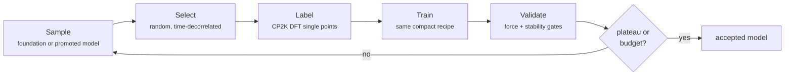

# CP2K-FORGE

**CP2K-FORGE** — *Foundation-model Optimisation of Reference Generation and Evaluation
in CP2K* — forges a small, fast, **system-specific** [MACE](https://github.com/ACEsuit/mace)
interatomic potential from a MACE foundation model, with [CP2K](https://www.cp2k.org) as
the DFT labelling engine.

The idea in one sentence: **the foundation model is not a teacher; it only proposes where
target-level DFT should be spent.** Every training energy and force comes from a CP2K
Quickstep single point at your chosen functional, so the final model's physics is exactly
that of the labelling level, with no inherited bias from the foundation model.

*DFT single points fan out across CPU nodes; there is no parent ab initio trajectory —
every DFT call is a training or validation label.*

## What it is — and is not

- **Foundation model = sampler only.** MD with a foundation model generates diverse,
  physically-sensible candidate structures. The structures are kept; its energies and
  forces are discarded. After the sampling switch, the newest accepted compact model
  generates the candidates for the next pass, keeping labels close to the distribution
  the final model will run in.
- **Labels = real DFT.** Every training structure gets a CP2K single point — semi-local
  GGA (for example revPBE-D3) or hybrid revPBE0-D3 under ADMM (`dft.mode: hybrid`).
- **Model = trained from scratch.** A compact MACE (96 channels, 2 interaction layers by
  default) learns only from the accumulated DFT labels.
- **NOT distillation** (the foundation model never labels), **NOT fine-tuning** (no
  inherited weights), **NOT query-by-committee** (the default selector draws random
  time-decorrelated frames).

## Does it work?

Both validation campaigns from the accompanying MPhil report stopped by the same
pre-registered convergence rule, not by the compute budget, and are head-to-head with a
published committee potential trained on two orders of magnitude more ab initio data:

| System (hybrid revPBE0-D3) | CP2K-FORGE | Published committee |
| --- | --- | --- |
| Water: force RMSE, 55 shared frames (meV/Å) | **53.3** | 64.6 |
| Water: RDF overlap vs 298 K experiment (%) | 95.6 | 95.6 |
| Water: training labels | **89** | 814 |
| Fluoride: force RMSE, 37 shared frames (meV/Å) | **57.7** | 69.4 |
| Fluoride: RDF / VDOS overlap vs AIMD (%) | 97.2 / **98.7** | 97.7 / 97.7 |
| Fluoride: training labels | **64** | 299 |

Full numbers, figures and the raw data files are in the
[case studies](case-studies/index.md); every value links back to the report section and
the vendored CSV it comes from.

## Why this exists

CP2K-FORGE is the capstone of a research arc, not a standalone tool: optimise CP2K's
native neural-network potential evaluator on CPU (accepted upstream into CP2K), move
it to GPU, extend CP2K to MACE through two backends — and only then ask whether CP2K
can build a compact model as well as run it. See
[Provenance → Why this exists](about/provenance.md#why-this-exists) for the full
chronology, with the GPU throughput and backend step-time figures that motivated it,
and where, how and by whom CP2K-FORGE was developed.

## What is it written in?

Pure **Python** (3.9+), published as the `cp2k-forge` package. It orchestrates two
external tools: **CP2K** (a Fortran code, executed as a subprocess — never imported or
linked; see [CP2K as a dependency](getting-started/cp2k-dependency.md)) and
**`mace_run_train`** (PyTorch, via the `mace-torch` package) for training. Campaigns are
one YAML file; CP2K inputs are rendered from templated `.inp` files shipped inside the
package.

## Start here

- [Installation](getting-started/installation.md) — one `pip install`, plus wherever
  your CP2K lives.
- [Quickstart](getting-started/quickstart.md) — a no-CP2K, no-GPU self-test in about two
  minutes, then a real campaign.
- [How it works](guide/how-it-works.md) — the loop, stage by stage.
- [Case studies](case-studies/index.md) — the water and fluoride campaigns with the
  report's data.
