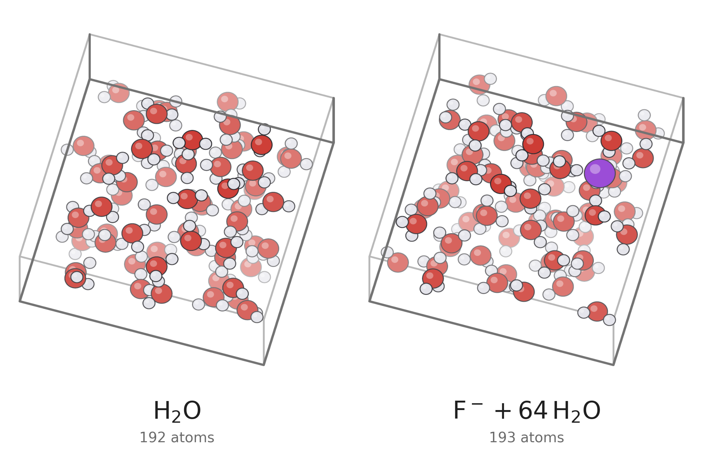
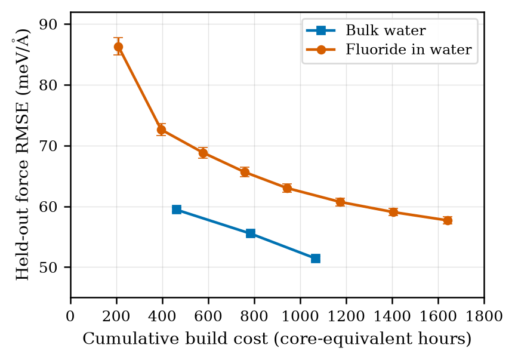

---
hide:
  - navigation
  - toc
---

<header class="research-hero">
  <div class="research-hero__text">
    <p class="document-type">Research software documentation</p>
    <h1>CP2K-FORGE</h1>
    <p class="expansion">Foundation-model Optimisation of Reference Generation and Evaluation in CP2K</p>
    <p class="abstract">A CP2K-centred route to compact, system-specific MACE potentials. A foundation model proposes configurations, CP2K labels selected frames with density functional theory, and fixed accuracy and stability checks decide whether the trained model can be deployed.</p>
    <nav class="hero-links" aria-label="Primary documentation links">
      <a href="getting-started/installation/">Installation</a>
      <a href="getting-started/quickstart/">Quickstart</a>
      <a href="guide/how-it-works/">Method</a>
      <a href="case-studies/">Validation study</a>
      <a href="reference/cli/">CLI reference</a>
    </nav>
    <div class="project-meta">
      <span>Python 3.9+</span>
      <span>MIT licence</span>
      <a href="https://github.com/DhruvSkyy/cp2k-forge">GitHub repository</a>
      <a href="about/provenance/">Thesis and citation</a>
    </div>
  </div>
  <figure class="research-hero__figure">
    
    <figcaption>Figure 1. The two validation systems used in the accompanying MPhil study: 64 water molecules, and one fluoride ion in 64 water molecules.</figcaption>
  </figure>
</header>

<div class="purpose-statement">
  <span>Purpose</span>
  <p>To build accurate, data-efficient potentials whose labelling, validation and deployed molecular dynamics remain inside one reproducible CP2K workflow.</p>
</div>

## Overview

Machine-learned interatomic potentials extend first-principles accuracy to longer molecular-dynamics simulations, but their reliability depends on consistent labelling, inference and validation. CP2K-FORGE brings these stages into one route. It uses CP2K Quickstep for the reference calculations, trains a compact MACE on the selected labels, and returns the candidate to CP2K for validation and deployment.

The foundation model is a sampler, not a teacher. Its trajectories provide candidate structures, but its predicted energies and forces are discarded. Every retained configuration is relabelled at the target DFT level. The final model therefore learns from CP2K labels alone and does not inherit the foundation model’s weights.

## Method

One YAML file defines the system, state points, DFT labelling level, compact-MACE recipe, validation gates and convergence rule. The campaign then repeats five stages.

<ol class="method-sequence">
  <li><span>01</span><div><h3>Sample</h3><p>Run short trajectories across the configured state points, first with a foundation model and later with the accepted compact model.</p></div></li>
  <li><span>02</span><div><h3>Select</h3><p>Remove time-correlated frames and select a small batch for reference calculations.</p></div></li>
  <li><span>03</span><div><h3>Label</h3><p>Evaluate independent CP2K DFT single points. These are the only energies and forces used for training.</p></div></li>
  <li><span>04</span><div><h3>Train</h3><p>Fit the fixed compact-MACE recipe to the accumulated labels and export it for CP2K.</p></div></li>
  <li><span>05</span><div><h3>Validate</h3><p>Test held-out forces, short-range behaviour and stability in dynamics driven by the candidate itself.</p></div></li>
</ol>

The campaign continues until the pre-specified plateau rule fires or the label budget is reached. State is written after every stage, so CPU labelling and GPU training can run as separate jobs and an interrupted campaign resumes without repeating completed calculations.

<div class="docs-entry">
  <div>
    <h3>Run a campaign</h3>
    <p>Install the package, check the environment and execute the complete mock workflow without CP2K or a GPU.</p>
    <a href="getting-started/quickstart/">Quickstart →</a>
  </div>
  <div>
    <h3>Inspect the method</h3>
    <p>Follow the control flow from the configuration file to the campaign manifest and accepted model.</p>
    <a href="guide/how-it-works/">How it works →</a>
  </div>
  <div>
    <h3>Reproduce the study</h3>
    <p>Read the water and fluoride campaigns with their provenance, costs, raw values and stated limitations.</p>
    <a href="case-studies/">Case studies →</a>
  </div>
</div>

## Results

The workflow was tested on bulk water and fluoride in water with the same code and promotion logic. Both campaigns used hybrid revPBE0-D3 labels and stopped through the fixed convergence rule rather than at the compute limit. The comparison below is deliberately restricted to the shared ambient target; the published committee models cover a wider range of aqueous conditions.

<div class="evidence-layout">
  <div>
    <table class="academic-results">
      <thead><tr><th>System and measure</th><th>CP2K-FORGE</th><th>Committee</th></tr></thead>
      <tbody>
        <tr class="table-section"><th colspan="3">Bulk water</th></tr>
        <tr><td>Training labels</td><td>89</td><td>814</td></tr>
        <tr><td>Force RMSE, 55 shared frames</td><td>53.3 meV Å<sup>−1</sup></td><td>64.6 meV Å<sup>−1</sup></td></tr>
        <tr><td>RDF overlap with 298 K experiment</td><td>95.6%</td><td>95.6%</td></tr>
        <tr class="table-section"><th colspan="3">Fluoride in water</th></tr>
        <tr><td>Training labels</td><td>64</td><td>299</td></tr>
        <tr><td>Force RMSE, 37 shared frames</td><td>57.7 meV Å<sup>−1</sup></td><td>69.4 meV Å<sup>−1</sup></td></tr>
        <tr><td>RDF / VDOS overlap with AIMD</td><td>97.2 / 98.7%</td><td>97.7 / 97.7%</td></tr>
      </tbody>
    </table>
    <p class="table-caption">Table 1. Reported hybrid revPBE0-D3 results. Force comparisons use the same held-out frames for each pair of models.</p>
  </div>
  <figure>
    
    <figcaption>Figure 2. Held-out force error against cumulative build cost. Error bars are bootstrap uncertainties.</figcaption>
  </figure>
</div>

### Why force error is not enough

The water campaign showed why a force score cannot be the deployment criterion. Some warm-started candidates fitted held-out forces well and then collapsed in molecular dynamics. A candidate is therefore promoted only if it improves the frozen force set, passes a compressed-dimer screen and survives a short CP2K trajectory driven by its own forces. RDF and VDOS comparisons remain post-deployment diagnostics.

<div class="note-grid">
  <section>
    <h3>Demonstrated</h3>
    <p>Selected DFT labelling, compact-MACE training, conservative promotion, convergence detection, resumability and deployment through the CP2K force interface.</p>
  </section>
  <section>
    <h3>Outstanding checks</h3>
    <p>The two campaigns do not establish universal transferability. Density at the hybrid level and a species-weighted fluoride convergence rule remain to be tested.</p>
  </section>
</div>

## Installation

```bash
pip install "cp2k-forge[train]"
cp2k-forge --check
cp2k-forge --config configs/smoke.yaml
```

The smoke configuration exercises the complete orchestration path on a laptop in about two minutes, using mock labels instead of CP2K. For a scientific campaign, continue with the [installation guide](getting-started/installation.md), [CP2K dependency notes](getting-started/cp2k-dependency.md) and [HPC guide](guide/campaigns-hpc.md).

## Citation and provenance

CP2K-FORGE was developed by Dhruv Sharma as part of the 2026 MPhil in Scientific Computing at the University of Cambridge. The methodology, validation protocol, results and limitations are documented in *Machine-Learned Interatomic Potentials in CP2K*. See [provenance and citation](about/provenance.md) for the research chronology and citation record.
